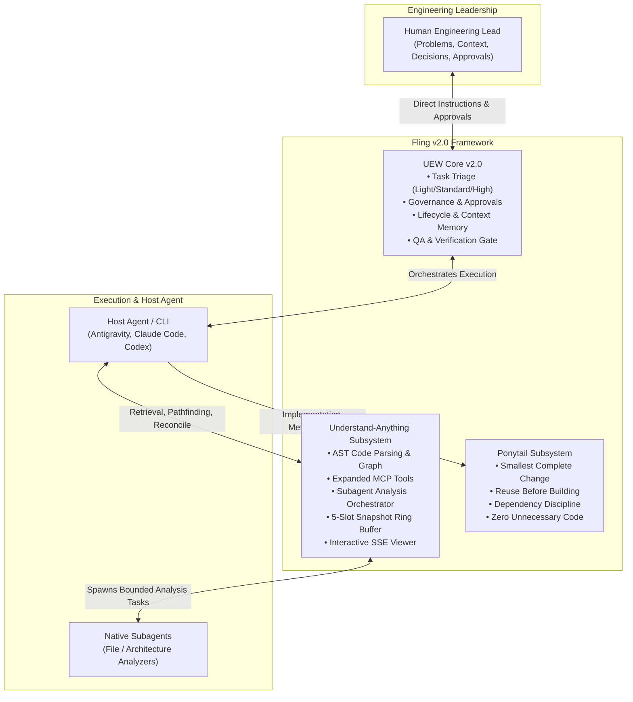
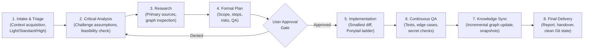

# Fling

> **A user-led, AI-assisted engineering framework integrating governance, codebase intelligence, and implementation discipline.**

[](LICENSE)
[](VERSION)
[](https://github.com/TNInjas/Fling/actions/workflows/validate.yml)

**Repository:** [https://github.com/TNInjas/Fling](https://github.com/TNInjas/Fling)  
**Authoritative Manual:** [`AGENTS.md`](AGENTS.md)  
**Distribution Version:** `2.0.0`

---

## Table of Contents
1. [Introduction](#1-introduction)
2. [Core Architecture](#2-core-architecture)
3. [Execution Lifecycle](#3-execution-lifecycle)
4. [Key Capabilities](#4-key-capabilities)
5. [Supported Coding Environments](#5-supported-coding-environments)
6. [Installation and Setup](#6-installation-and-setup)
7. [Usage Guide](#7-usage-guide)
8. [Repository Structure](#8-repository-structure)
9. [Configuration and Customization](#9-configuration-and-customization)
10. [Testing and Quality Assurance](#10-testing-and-quality-assurance)
11. [Security and Permissions](#11-security-and-permissions)
12. [Limitations](#12-limitations)
13. [Roadmap](#13-roadmap)
14. [Contributing](#14-contributing)
15. [License and Third-Party Notices](#15-license-and-third-party-notices)
16. [Acknowledgements](#16-acknowledgements)

---

## 1. Introduction

Autonomous code generation without structured engineering discipline creates fragile software, architectural drift, bloated dependencies, and unverified diffs. 

**Fling** addresses this challenge by establishing an explicit, user-directed engineering workflow:

> **You think, decide, and direct. The agent investigates, challenges assumptions, plans, implements, and verifies.**

The coding agent is not an unconstrained developer with unchecked authority. It operates as an engineering partner, critical reviewer, and implementation agent. It is expected to constructively challenge weak reasoning with evidence and alternatives, while never quietly replacing user decisions with its own or executing unapproved recommendations.

Fling brings together three complementary engineering disciplines into a cohesive monorepo:
1. **Engineering Governance (UEW Core):** Multi-tier task triage, explicit approval boundaries, continuous verification, and persistent architectural context.
2. **Codebase Intelligence (Understand-Anything):** Machine-indexed AST knowledge graphs, semantic search, k-hop dependency pathfinding, git diff reconciliation, and visual inspection.
3. **Implementation Discipline (Ponytail):** Minimal effective diffs, aggressive component reuse, platform stdlib utilization, and dependency restraint.

---

## 2. Core Architecture

Fling is structured into three strictly orthogonal components with well-defined responsibility boundaries:



### Responsibility Boundaries

| Component | Responsibility Scope | What It Does NOT Own |
|---|---|---|
| **UEW Core** | Task classification, user authority, approval boundaries, verification gates, delivery handover, and memory hierarchy. | Code implementation heuristics, low-level AST parsing, or graph visualization. |
| **Understand-Anything** | Structural/semantic codebase scanning, indexed knowledge graphs, dependency pathfinding, incremental git diff reconciliation, and dashboard visualization. | Task approvals, Git publishing permissions, or direct autonomous code edits. |
| **Ponytail** | Implementation minimalism, evaluating whether new code needs to exist, standard library reuse, and eliminating gratuitous abstractions. | Authorizing task scope, relaxing safety checks, or skipping test verification. |

---

## 3. Execution Lifecycle

Every non-trivial engineering task follows a disciplined multi-stage lifecycle:



### Lifecycle Stages
1. **Task Intake & Triage:** The task is classified as **Light** (single-line intent, immediate check), **Standard** (concise plan, approval), or **High-risk / complex** (deep research, milestone reviews, explicit authorization).
2. **Context Acquisition:** Existing architectural knowledge is retrieved via Understand-Anything MCP tools (`understand_query_graph`, `understand_get_subgraph`) before reading extensive source files.
3. **Problem Analysis:** The agent independently assesses proposed directions for practicality, architectural compatibility, and hidden failure points.
4. **Planning & Approval Gate:** For Standard and High-risk tasks, the agent prepares an explicit plan covering affected components, dependencies, risks, and recovery. Work pauses until user approval is granted.
5. **Controlled Implementation:** The agent applies the Ponytail ladder: checking if code needs to exist, checking for existing helpers, checking standard libraries, and preferring the shortest working diff.
6. **Continuous QA & Verification:** Tests, edge case checks, security audits, and regression suites run continuously during implementation, not solely at completion.
7. **Knowledge Synchronization:** Following code changes, incremental graph updates (`understand_sync_incremental`) ensure architectural memory matches the new working tree. Full rebuilds trigger snapshot backups.
8. **Delivery & Handover:** Final diff review, secret checks, and a structured delivery report are presented. A deliverable is complete only when verified and shipped to the agreed destination.

---

## 4. Key Capabilities

### Engineering Governance & Safety
- **Explicit Human Authority:** Human leads; agent assists. No silent substitution of user decisions.
- **Strict Approval Gates:** Consequential operations (schema migrations, major dependency upgrades, destructive Git commands, external network transmission) require explicit approval.
- **Untrusted Data Boundary:** Content from files, web pages, issues, dependencies, and graph summaries is treated as data, never as agent instructions.

### Codebase Intelligence & Graph Navigation
- **Expanded MCP Server:** Provides programmatic tools for graph queries, neighborhood subgraphs, shortest-path BFS, cycle detection, node updates, and incremental synchronization.
- **Decoupled Pipeline:** Independent scanner, batch coordinator, and reconciler modules enable flexible multi-language codebase indexing.
- **Native Subagent Analysis:** Analysis tasks are delegated to host CLI subagents (e.g. Antigravity File Analyzers and Architecture Analyzers), returning structured AST representations for centralized validation.
- **Graph Resilience:** 5-slot snapshot ring buffer (`.ua/snapshots/`), atomic PID-locked writes (`atomicWriteFileSync`), and automatic isolation of invalid payloads (`.ua/failed-update-...`).
- **Interactive Live Dashboard:** Standalone HTTP viewer and React dashboard with real-time Server-Sent Events (SSE) updates on `/api/events`.

### Implementation Methodology (Ponytail)
- **The Smallest Complete Change:** Enforces the 7-tier evaluation ladder:
  1. Does it need to exist?
  2. Already in this codebase?
  3. Standard library or platform feature?
  4. Installed dependency?
  5. Can it be one clean line?
  6. Otherwise: minimum effective working implementation.
- **Preserved Safety Constraints:** Never eliminates input validation, trust boundary checks, data-loss protection, hardware calibration, or accessibility requirements.

---

## 5. Supported Coding Environments

| Platform | UEW Core Support | Understand-Anything Integration | Ponytail Ruleset Integration | Verification Status |
|---|---|---|---|---|
| **Antigravity CLI** | Native (`global/AGENTS.md`, `skills/`) | Full (MCP Server + Native Subagent Delegation verified) | Native (`.agents/rules/ponytail.md` + 6 active skills) | **`VERIFIED`** (Tested live in session) |
| **Claude Code** | Compatible via root `AGENTS.md` | Programmatic MCP Server; sequential analysis driver | Compatible via `.clinerules/` / root rules | **`STATIC-ONLY`** (Code complete; unverified runtime) |
| **Codex** | Compatible via root `AGENTS.md` | Programmatic MCP Server; sequential analysis driver | Compatible via `.codex-plugin/` / root rules | **`STATIC-ONLY`** (Code complete; unverified runtime) |

---

## 6. Installation and Setup

### Prerequisites
- **Git** (>= 2.30)
- **Bash** (POSIX-compliant shell)
- **Node.js** (>= 22.0.0; required for Understand-Anything TypeScript monorepo)
- **pnpm** (>= 9.0.0; monorepo package manager)
- **Antigravity CLI** (or compatible agentic coding environment)

### 1. Clone the Repository
```bash
git clone https://github.com/TNInjas/Fling.git
cd Fling
```

### 2. Install Dependencies & Build Subsystems
```bash
# Install monorepo workspace dependencies
pnpm install

# Build the Understand-Anything core engine and viewer assets
pnpm run prepare
pnpm run build
```

### 3. Install Global Instructions (Antigravity CLI)
```bash
# Preview target installation paths (dry run)
./install.sh --dry-run

# Perform installation to ~/.gemini/config/
./install.sh
```

### 4. Install Recommended Companion Repositories & Tooling
To unlock Fling's full capability spectrum—including structured specification design, independent AI code reviews, implementation minimalism, and comprehensive software engineering skills—install these official companion repositories and plugins:

#### A. Elephant & Goldfish Model (EGM)
EGM provides multi-persona specification design, adversarial stress-testing, brainstorming (`/egm:egm-brainstorm`), documentation bootstrap (`/egm:egm-bootstrap`), and architecture drift reviews.
- **Repository:** [`https://github.com/google/elephant-goldfish-model`](https://github.com/google/elephant-goldfish-model)
- **Installation in Antigravity CLI:**
  ```bash
  agy plugin install https://github.com/google/elephant-goldfish-model
  ```

#### B. CodeRabbit (AI Code Review)
CodeRabbit provides automated, high-signal pre-merge reviews for pull requests and local uncommitted changes, as well as safe autofixing.
- **Agent Skills Plugin Repository:** [`https://github.com/coderabbitai/skills`](https://github.com/coderabbitai/skills)
- **CLI Documentation & Binary:** [`https://github.com/coderabbitai/coderabbit-cli`](https://github.com/coderabbitai/coderabbit-cli)
- **Setup & Authentication:**
  ```bash
  # 1. Install CodeRabbit CLI
  curl -fsSL https://coderabbit.ai/install.sh | sh
  # (Alternatively on macOS / Linux Homebrew: brew install coderabbitai/tap/coderabbit)

  # 2. Authenticate the CLI
  coderabbit login

  # 3. Install CodeRabbit Skills Plugin in Antigravity
  agy plugin install https://github.com/coderabbitai/skills
  ```

#### C. Ponytail (Minimalist Implementation Methodology)
Enforces minimal viable diffs, anti-overengineering heuristics, and standard library reuse.
- **Repository:** [`https://github.com/DietrichGebert/ponytail`](https://github.com/DietrichGebert/ponytail)
- **Installation in Antigravity CLI:**
  ```bash
  agy plugin install https://github.com/DietrichGebert/ponytail
  ```

#### D. Agent Skills (General Engineering Skills Suite)
Provides 25+ specialized agent capabilities including TDD, API design, security hardening, performance profiling, and browser devtools testing.
- **Repository:** [`https://github.com/addyosmani/agent-skills`](https://github.com/addyosmani/agent-skills)
- **Installation in Antigravity CLI:**
  ```bash
  agy plugin install https://github.com/addyosmani/agent-skills
  ```

### 5. Verify the Installation
```bash
# Execute the automated package smoke tests
npm run test:uew

# Execute the Understand-Anything core unit test suite
npm run test:ua:core
```

---

## 7. Usage Guide

### Starting Work on a Codebase
1. **Intake & Freshness Check:** The agent checks for an existing knowledge graph in `.ua/` or `.understand-anything/`.
2. **Targeted Retrieval:** The agent invokes `understand_query_graph` or `understand_get_subgraph` to locate entry points and callers before opening large files.
3. **If Graph is Absent:** Run the analysis orchestrator or invoke the standalone viewer:
   ```bash
   node subsystems/understand-anything/understand-anything-plugin/packages/viewer/bin/viewer.mjs . --port 5299
   ```

### Executing a Feature Implementation
1. **Task Classification:** Agent proposes: `"Standard: Implement OAuth callback endpoint."`
2. **Dependency Tracing:** Agent traces upstream callers and checks for cycles via `understand_find_path`.
3. **Proposal & Approval:** Agent presents a concise plan outlining affected files, testing strategy, and risk mitigation.
4. **Ponytail Discipline:** Agent checks if existing database clients and authentication middleware can be reused without new dependencies.
5. **Incremental Sync:** Upon implementation, the agent reconciles the AST graph:
   ```bash
   # Changes are detected and reconciled incrementally
   npm run test
   ```

---

## 8. Repository Structure

```text
Fling/
├── AGENTS.md                                  # Authoritative UEW v2.0 manual & Fling project rules
├── .agents/
│   └── rules/
│       └── ponytail.md                        # Antigravity project-level Ponytail ruleset
├── global/
│   └── AGENTS.md                              # Machine-level rules packaged by install.sh
├── skills/
│   └── universal-engineering/
│       └── SKILL.md                           # Progressive-disclosure workflow skill
├── docs/
│   ├── ARCHITECTURE.md                        # Tripartite architecture specification
│   ├── UNDERSTAND-ANYTHING.md                 # Detailed knowledge engine documentation
│   ├── INSTALLATION.md                        # Standalone installer guide
│   ├── COMPATIBILITY.md                       # Environment and platform matrix
│   ├── PLUGIN-INTEGRATION.md                  # EGM and CodeRabbit integration guide
│   ├── RELEASE-CHECKLIST.md                   # Release validation runbook
│   └── Universal Engineering Workflow...pdf  # Foundational specification PDF
├── subsystems/
    ├── understand-anything/                   # Understand-Anything subsystem monorepo
    │   ├── packages/
    │   │   ├── core/                          # Scanner, orchestrator, graph, persistence, security
    │   │   ├── mcp/                           # Expanded Model Context Protocol server
    │   │   ├── viewer/                        # Standalone HTTP server & SSE live sync
    │   │   └── dashboard/                     # React + Vite visual graph dashboard
    │   ├── skills/                            # Internal analysis scripts
    │   ├── agents/                            # Role definitions for native subagent delegation
    │   ├── tests/                             # Subsystem integration and E2E suites
    │   └── AGENTS.md                          # Subsystem-scoped operational guidelines
    └── ponytail/                              # Ponytail implementation methodology subsystem
        ├── UPSTREAM.md                        # Upstream commit tracking (v5.3.3) and license note
        └── upstream/                          # Vendored upstream source tree (unmodified)
├── templates/
│   ├── project-agent/AGENTS.md                # Template for project-specific instructions
│   └── task-artifacts/                        # Templates for plans, research, and decisions
├── tests/
│   └── test-install.sh                        # Automated installer/uninstaller smoke tests
├── install.sh                                 # Standalone POSIX package installer
├── uninstall.sh                               # Standalone POSIX package uninstaller
├── package.json                               # Root monorepo orchestration manifest
├── pnpm-workspace.yaml                        # Pnpm workspace definition
├── CHANGELOG.md                               # Release history and migration guide
├── CONTRIBUTING.md                            # Open source contribution guidelines
├── SECURITY.md                                # Vulnerability reporting policy
├── THIRD-PARTY-NOTICES.md                     # Open source licenses for integrated projects
├── SOURCE-TRACEABILITY.md                     # Component mapping and upstream provenance
└── LICENSE                                    # Root MIT License
```

---

## 9. Configuration and Customization

- **Universal Rules:** Configured in `global/AGENTS.md` and installed globally via `./install.sh`.
- **Project-Specific Instructions:** Placed in root `AGENTS.md` (or copied from `templates/project-agent/AGENTS.md` for new repositories).
- **Subsystem Rules:** Isolated in `subsystems/understand-anything/AGENTS.md` and `.agents/rules/ponytail.md` to prevent global rule bloat.
- **Working Notes:** Maintained in `.agent/` (`.agent/task-state.md`, `.agent/session-handover.md`); kept untracked by default.

---

## 10. Testing and Quality Assurance

Fling enforces continuous verification across all components.

### Verified Test Suites & Execution Commands

```bash
# 1. Package Installation Smoke Tests (POSIX Shell)
# Verifies dry-run safety, path overrides, overwrite guards, and clean uninstall
npm run test:uew
# Result: 9 passed, 0 failed

# 2. Understand-Anything Core Unit Tests (Vitest)
# Verifies AST extractors, scanner, batcher, merger, pathfinder, locking, and recovery
npm run test:ua:core
# Result: 60 test files, 1,060 passed, 0 failed

# 3. Understand-Anything Dashboard Unit Tests (Vitest)
# Verifies layout algorithms, filtering, staleness detection, and live-sync hooks
npm run test:ua:dashboard
# Result: 18 test files, 126 passed, 0 failed

# 4. Customization Targets & Integration Tests
# Verifies the 10 customization targets, expanded MCP server, and SSE stream
pnpm vitest run subsystems/understand-anything/tests/
# Result: 23 test files, 658 passed, 3 skipped, 0 failed

# 5. Shell Script Syntax Check
bash -n install.sh uninstall.sh tests/test-install.sh
# Result: 0 syntax errors
```

---

## 11. Security and Permissions

- **Adaptive Permission Model:** Reading files and inspecting Git status are automatic. Mutating code within an approved plan is adaptive. Consequential actions (dependencies, external API transmissions, branch/commit operations) require authorization.
- **Destructive Operations Guard:** Force-pushes, history rewrites, remote branch deletions, and unconditional resets are strictly forbidden without explicit approval.
- **Path Sanitization:** Understand-Anything enforces strict project-root containment (`PathValidator`), neutralizing path-traversal attacks (`../../etc/passwd`) and outside symlink escapes.
- **Secret Redaction:** `SecretRedactor` automatically filters API keys, bearer tokens, private keys, and passwords before graph indexing or persistent serialization.
- **Atomic File Operations:** Graph writes use `atomicWriteFileSync` (writing to a PID-tagged temporary file, flushing buffers via `fsyncSync`, and performing an atomic rename).

---

## 12. Limitations

1. **Host-Specific Delegation:** Native subagent spawning via `AntigravityDriver` is verified in Antigravity CLI. Claude Code and Codex drivers are implemented and unit-tested, but runtime delegation depends on host CLI support.
2. **Headless Visual Rendering:** The dashboard HTTP server, REST endpoints, and SSE stream (`/api/events`) operate headlessly. Canvas rendering requires a modern web browser.
3. **No Automatic Runtime Rule Switching in Antigravity:** Dynamic mode switches (`/ponytail lite|full|ultra`) operate on a per-command basis; Antigravity CLI does not support persistent runtime mode mutation via hooks.

---

## 13. Roadmap

- [ ] **Native Delegation Adapters:** Expand verified subagent drivers for Claude Code and Codex.
- [ ] **Multi-Repository Knowledge Graphs:** Support cross-repository dependency exploration for microservice architectures.
- [ ] **Language Server Protocol (LSP) Bridges:** Complement Tree-sitter AST extraction with deep type-inference data from language servers.

---

## 14. Contributing

Contributions are welcomed. Please review [`CONTRIBUTING.md`](CONTRIBUTING.md) for pull request guidelines, test requirements, and coding standards.

---

## 15. License and Third-Party Notices

- **Fling:** Released under the [MIT License](LICENSE) &copy; 2026 Tanay Soni and Fling Contributors.
- **Understand-Anything Subsystem:** MIT License &copy; 2026 Egonex AI and Understand-Anything Contributors.
- **Ponytail Subsystem:** MIT License &copy; 2026 Dietrich Gebert.
- Complete licensing terms and attribution are documented in [`THIRD-PARTY-NOTICES.md`](THIRD-PARTY-NOTICES.md) and [`SOURCE-TRACEABILITY.md`](SOURCE-TRACEABILITY.md).

---

## 16. Acknowledgements

- **Google** for the [Elephant & Goldfish Model (EGM)](https://github.com/google/elephant-goldfish-model) specification design framework.
- **CodeRabbit** for the [CodeRabbit Skills](https://github.com/coderabbitai/skills) AI code review platform.
- **Dietrich Gebert** for creating [Ponytail](https://github.com/DietrichGebert/ponytail) and championing minimalism in software development.
- **Addy Osmani** for the [Agent Skills](https://github.com/addyosmani/agent-skills) suite.
- **Egonex AI** and the [Understand-Anything](https://github.com/Egonex-AI/Understand-Anything) community for the foundational knowledge graph architecture.
- **Google DeepMind** for the Antigravity CLI environment and customization architecture.
